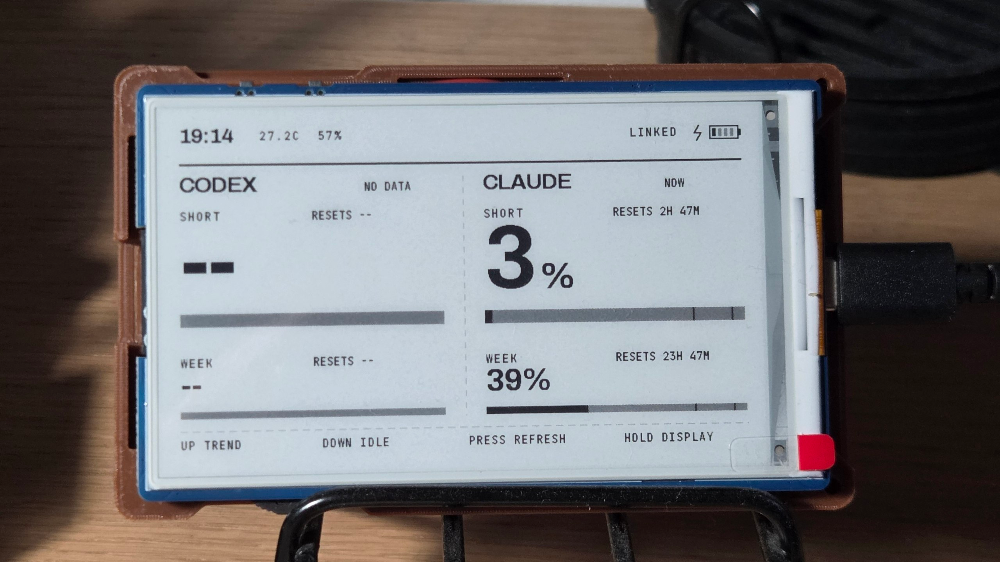
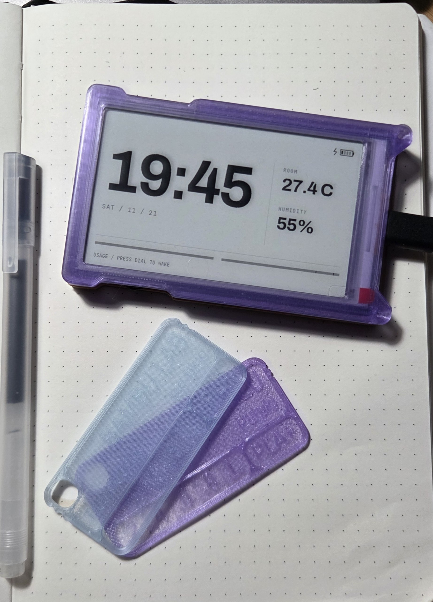

## What's Been Happening

About a month ago, I started a new [project to assemble an e-reader](https://debugled.com/projects/project-e-reader/) for myself. After getting a battery for it, I've been trying to figure out the enclosure. The one I was planning on using is for a smaller battery (lower height). So now I'm printing the enclosure for a test fit.

Meanwhile, I didn't let it sit here collecting dust. Well, that too, but it's at least semi-usefull and let me play around with ESP-IDF for a bit.

I've wanted to have a Claude usage tracker on my desk for a while. So I can glance and know where I'm at with my usage while developing. 

And so I flashed the [QuotaFrame](https://quotaframe.com/en/) firmware on it. This is a Codex + Claude usage tracker.

And boy what a ride that was. 

## How it all connects

First, let me just start by prefacing this that to get this working, There are 3 components to it: The **QuotaFrame FW** (for which the repo is pretty generous I might add, with 6 ESP32-based supported boards), the desktop Bluetooth connecting app **QuotaFrame Bridge** and the usage tracker itself **CodexBar**.

So the way it works is CodexBar gets the usage from Claude (and Codex if you use it as well), QuotaFrame bridge reads the usage from CodexBar and connects to the ESP32 via bluetooth to send the information over.

It looks nice now, although I'd like for it to only show Claude usage, since I'm not using Codex right now. But that's a project for another day... Or month, really 👀

*Ok, real quick: I'm thinking I can create a firmware that gets usage directly from Claude through Wifi, with no bridges in between. It would be a cool little project to work with an ESP32. I'm thinking of using another board though. Later. Maybe. **VERY** maybe.*

## Hungry Hungry Debugger

Making this work took some horus. And man, did I learn something.

At first, I flashed the board through the QuotaFrame web-flasher - which, by the way, is a very nice tool - but something wasn't working properly after flashing, so I tried again. 

Somewhere along the way I had issues flashing the board because the flash failed  and it took me (quite) a bit to realise that this board has a power management circuit that is semi-controlled by the firmware. For those of you don't know, basically the firmware holds the power line ON with a transistor after it boots up. This is very common practice and good design so the firmware can shutdown the power if needed.

Issue is: if the firmware didn't flash properly, nothing is holding that power line. So the board dies after 6/7 seconds of being plugged in. To power the board when this happens, you have to hold down the power button while flashing a new firmware.

Now, since the firmware was corrupted, the board wasn't booting properly. So even holding the power button wasn't enough to flash it again. 

In this case, you need to hold both the PWR and BOOT buttons at the same time and after 2 seconds release the BOOT button while holding the PWR button. This puts the ESP32 in download mode (basically just waits to be flashed). Now, it took me a while to figure this out, even though I've worked closely on a board that had this feature before. To be fair, it was late and I hadn't had anything to eat in some hours.

Lesson learned: don't debug while hungry. 

Also if a board has exposed PWR and BOOT buttons, they are there for a reason. I won't be forgetting that one for a while.

Apparently, the IDF version I was using also had reported problems flashing this board. It was throwing me some errors about a toolchain or something of the sort (can't remember right now to be honest). So I installed a previous version and tried with it. It worked.

Ok, good. At least that's something. I can now flash the firmware.

Then came the desktop apps. I installed *QuotaFrame Bridge* and *CodexBar*, connected them to each other and to my Claude account. Then tried connecting the ESP32 to *QuotaFrame Bridge* through Bluetooth. Took me some tries to get it. ESPs are not famous for their bluetooth stack. 

After that, it took me quite some time to make every one play nicely with each other. Which by the time it took me, I was already *very* hungry. This was not the best idea, but that part of me that *just wants to finish it* couldn't go away. *This time for sure it will work... Just one more reconnect, one more reboot, one more try...* 

And that was my biggest mistake. By the end of it, I was just tired and hungry. There was no room for joy from finally cracking it and making it work.

I should have stopped 2 hours ago, go eat something and comeback to finish on a full stomach and an clear head. 

If there's anything I take away from this whole experience is that which I already knew: If you're stuck, take a break and come back later. A full head and being tired will get you nowhere good.

## What's Next

Now I'm figuring out fittings for the casing. I might make it work. The issue is small, it's maybe 0.5mm of extra height from the battery that's hitting the display's FPC connector. I might be able to just raise the height of the enclosure enough for it to not *squish* the battery.

While I'm at it, I'm trying out some fun colors. I think I have an idea.

I'll update the [e-reader Project page](/projects/project-e-reader) *Soon™*