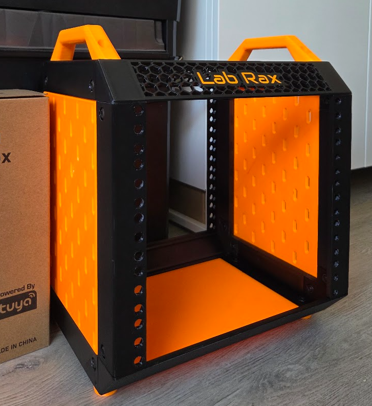
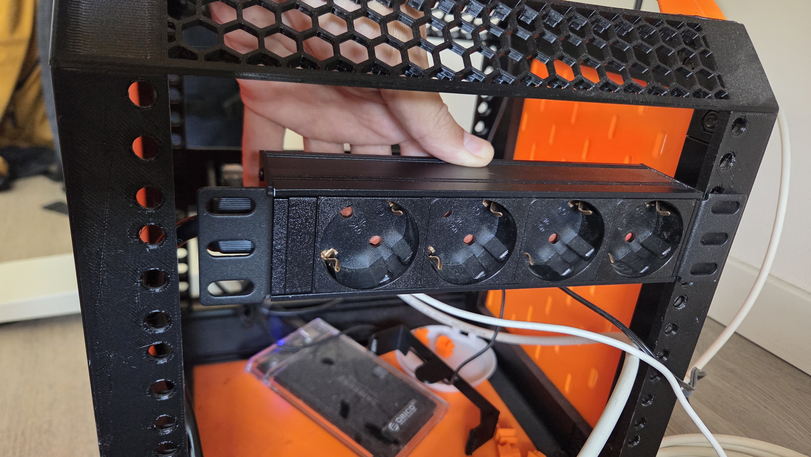
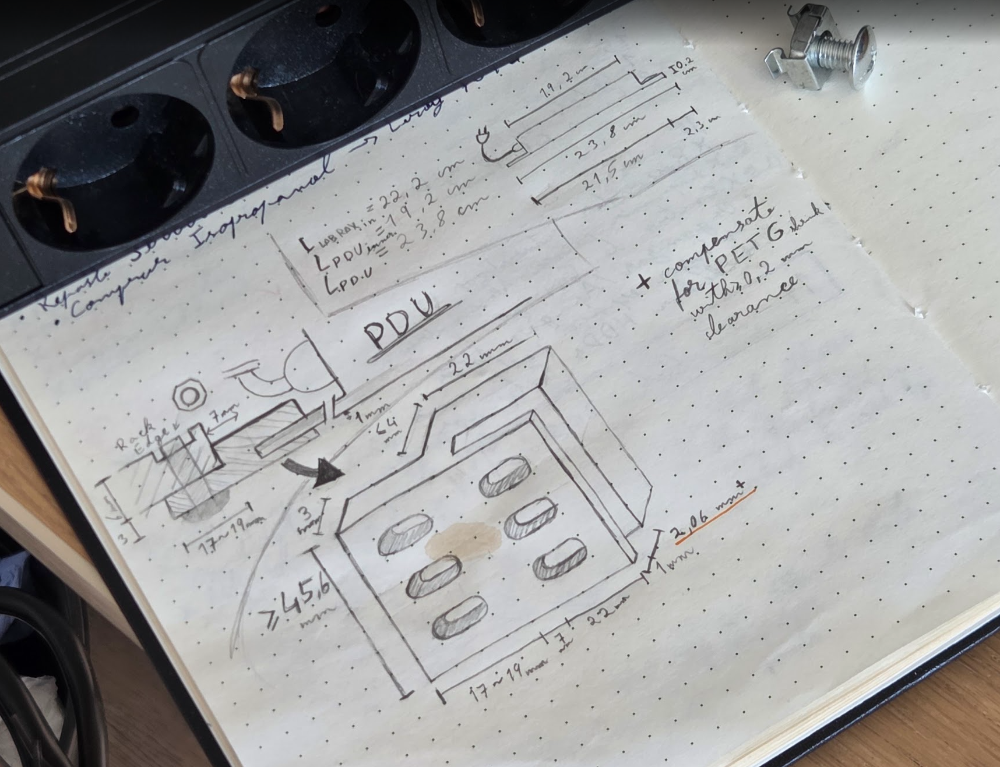
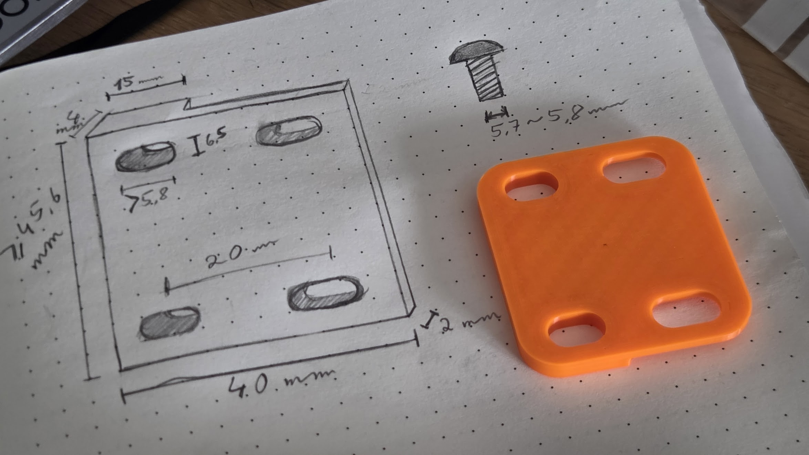
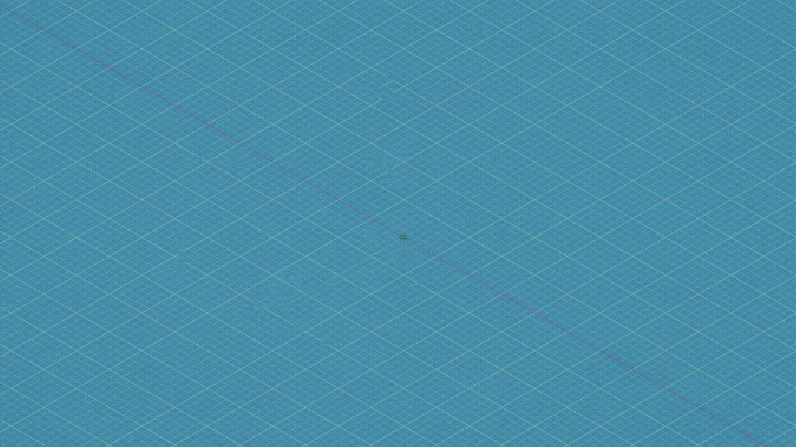
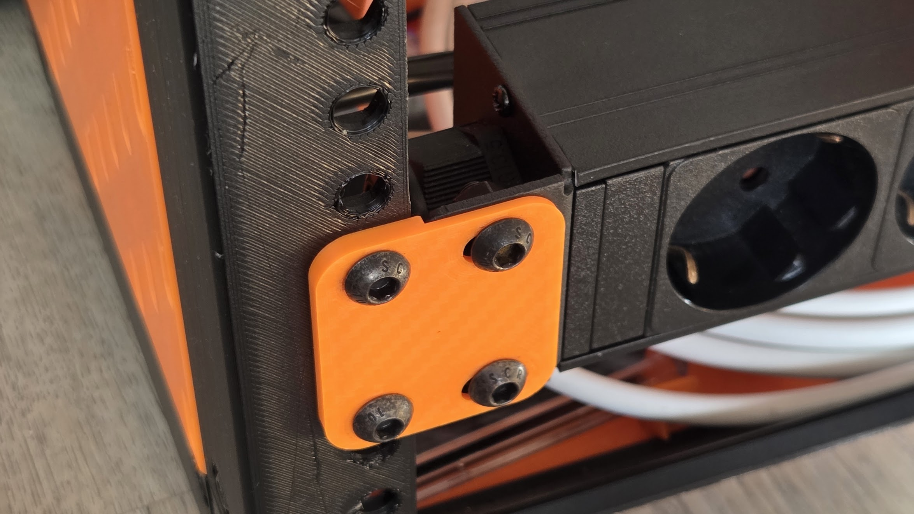
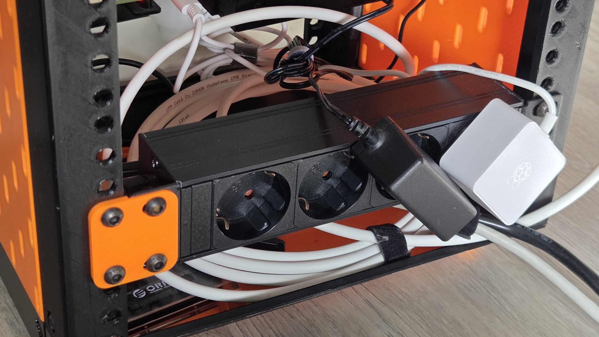
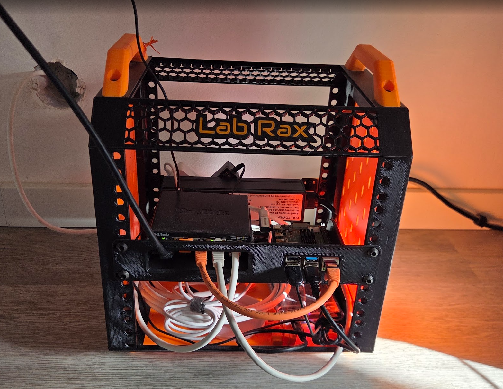

## A Small, 0.6" Mistake
I bought a PDU for my 10" rack so it was better organized.

I failed to notice that this PDU was, in fact, not 10" long, but 9.4".

So this left me with a PDU I couldn't install in my rack 🙃

## Why do I even need this special power strip?

Last year, I 3D printed [a small 10" rack](https://makerworld.com/en/models/1294480-lab-rax-10-server-rack-5u?from=search#profileId-1325352) for my home lab. 

This is where I house my network switch and the Raspberry Pi 4B that runs my Home Assistant and network tools like Pihole. I plan on adding more gear to it like another Rapsberry and an Access Point for better Wifi in the office.

For organization's sake, I bought a PDU so all my devices were neatly connected to a dedicated power block rather than to an external power strip laying around on the floor.

A dedicated PDU means everything's connected to 1 single point and I have only 1 power cable coming out of the rack. This makes it easier to move the rack or diagnose any issues with a device.

## 1" makes a difference

If anyone's ever told you that size doesn't matter, they lied. 

The PDU I bought is 9.4" (23.8cm) long end to end. Now for the more astute of my readers, you might realize that 9.4" is - in fact - smaller than 10" (25.4cm). This means the PDU does not reach the end of the rack when mounted to one side.

## How I fixed this

Now, any other person might've just returned the PDU and gotten a larger one when they found out about the size issue.

I, like the tinkerer I am, thought "I can just 3d print an extension or something to fix this".

So, that's what I *didn't do for 2 months!* Until last week when I decided it was taking up too much space in a drawer and being too useless.

So I looked up 3d designs of some sort of adapter for it. Of course, this is so niche, there were none.

That meant I had to design one. 

I started off taking measurements and designing around the gap that exists between the rack and the PDU.

At first I wanted to make sure the PDU's "ear"? I don't know how to call it. The protruding part with the holes where you screw it into the rack. Anyway, I'm calling it ear. And it has piercings. The screws are piercings. Can't change my mind now.

As I was saying, I wanted to make sure the PDU's ear was well secured and that the 3d print held fine without breaking from stress on the horizontal plane. This lead me to design a sort of C shaped fixture around the ear that could be attached with a bolt and nut combo so it didn't suffer from stress horizontally.

But after drawing it, I started to realize it would be a pain to print. If I print it standing up, the holes will droop or require supports. 
If I print it lying down, it will still require supports in the inside of the C shape that goes around the PDU's ear. Which, by experience, is worse than supporting holes. Plus it would make it more brittle on the horizontal axis, which was my worry.

I felt it was unecessarily complex. And if there's one thing I've learned in 7 years working is that there *is* such a thing as over-engineering.

## Re-design and solution

After some minutes of consideration and looking at the front panels I had installed on my rack, I decided I should just simplify the design and make it simillar to what already worked.

This resulted in a simpler design, that prints horizontally, with no supports and has perfect holes for the screws to pass through. And by experience, it holds up just fine for this use-case.

So I booted up Fusion and got to work designing this from scratch. 

Then I just had to export it, load it up in OrcaSlicer and send it off to the printer. Less than 30 minutes after I had it ready to install.

It installed nicely. Could've maybe use less screws, but this way it looks better. Granted it's facing a wall, but it just gives me peace of mind 😅

## Wrapping up

It's good to think about creative solutions and design out of the ordinary solutions. 

But sometimes you have to take a step back and think to yourself *"Is there an easier or more efficient solution to this?"* before moving on to the execution phase.

Overall, I'm just happy to have *finally* closed this mini-project that should've taken 30 seconds to install but took a whole day to solve.

It's looking good and made me feel like upgrading the rack more. I'm thinking of replacing the switch + pi holder for one that actually holds my switch and that doesn't need a 90º USB-C adapter for the pi power cable.

## What's Next
For the rack/network setup:
 - Install the wall RJ45 plug (just bought some hardware for this)
 - Redesign and print the Switch + Pi holder
 - Buy and install an AP for better Wifi
 - Design a small Zigbee dongle holder for the side of the rack

I've been doing some upgrades to the website. And by "I've been doing" I mean I've been prompting Claude to do them. I have some more stuff I want to make happen in the website as well, so I'll do that for today.

Other than that, I also have everything I need to finally assemble the battery in the [ESP32 epaper book reader project](/projects/project-e-reader). More on that later. I think it's time to create a project page for it.