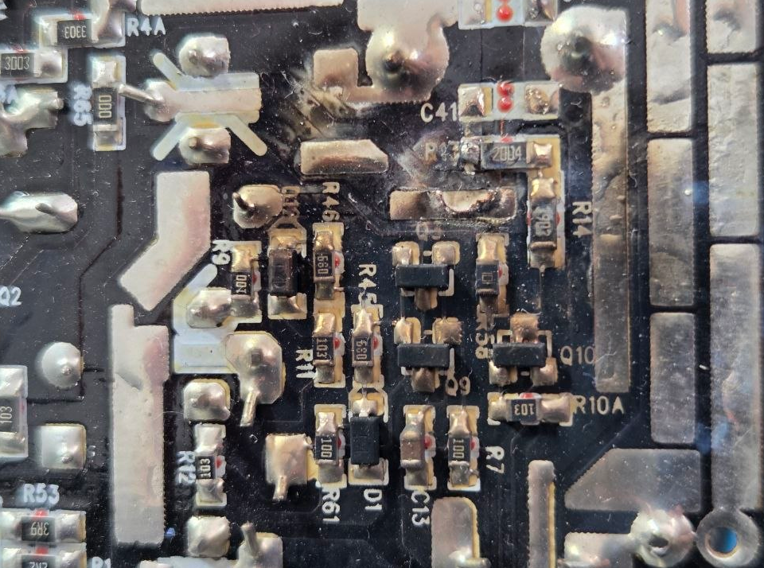

## The Problem

Old desktop PSU stopped working. At first only very sporadically, then constantly. Until I decided it wasn't safe to keep using and pulled it out. 

  

I contacted customer support because the PSU was still covered by the manufacturer's warranty. But to send them the PSU for check (not even repair), I'd have to pay postage. Then they would still have to evaluate if it was covered by the warranty. And even if they repaired it, the whole process would take weeks. 

I ended up just using a friend's PSU for a few months and then buying one when I upgraded my Desktop.

Now that I have some free time, I'm putting my soldering skills to use. I also want to learn something about hardware debug and repair, which is always usefull.

## The Solution

I'm going to put my soldering skills to work and try to fix it!

## Current State

I've disassembled the PSU and posted on Reddit about it.

And as <a href="https://www.reddit.com/r/ElectronicsRepair/comments/1uqz15b/help_repairing_a_seasonic_ssr650gb_s12iii650/" target="_blank" rel="noopener noreferrer">some folks on Reddit↗ (opens in a new tab)</a> pointed out, this will be a step-by-step approach.

I tried to resolder the trace that was recommended, but [the PSU blew up in my face](/blog/update-automation-and-planning/).

Now, either that trace was not supposed to be shorted, or there's something else shorting the board. Either way, I'm not sure how to follow up on this yet.

## What's Next

Not sure. Right now I have other more important/interesting projects going on. So this might be stored away for now.